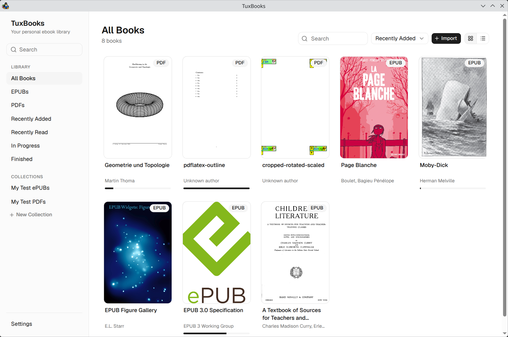

# TuxBooks

[](https://github.com/tuunanet/tuxbooks/actions/workflows/ci.yml)
[](https://github.com/tuunanet/tuxbooks/releases)
[](LICENSE.md)
[](docs/BUILD.md)
[](https://www.codefactor.io/repository/github/tuunanet/tuxbooks)
[](docs/COVERAGE.md)

A local-first, bookshelf-style desktop ebook library for Linux (Electron
desktop shell). Point it at a folder of EPUB and PDF files; it indexes
metadata and covers into a local SQLite database, keeps collections and reading
progress, and provides EPUB and PDF reading experiences.



## Stack

- **Desktop:** Electron (Chromium shell) with a Rust sidecar (tokio, serde,
  sqlx/SQLite, thiserror, proptest) speaking JSON-RPC over stdio
- **Frontend:** React 19, TypeScript (strict), Vite, Tailwind CSS 4, shadcn/ui
- **Testing:** Vitest + React Testing Library, Playwright Test
  (Playwright's Electron API), cargo test
- **Tooling:** pnpm, just, vite-plus (`vp`: Vite, Vitest, oxlint, oxfmt),
  rustfmt, clippy, GitHub Actions

## Install

Prebuilt packages (deb, AppImage) are on the
[releases page](https://github.com/tuunanet/tuxbooks/releases). TuxBooks is
pre-1.0 and still under active development:

```sh
# Ubuntu/Debian
sudo apt install ./tuxbooks_<version>_amd64.deb
# Any other Linux — portable, no installation
chmod +x tuxbooks_<version>_amd64.AppImage && ./tuxbooks_<version>_amd64.AppImage
```

Verify downloads against `SHA256SUMS.txt` in the same release. See
[docs/RELEASE.md](docs/RELEASE.md) for how releases are cut and packaged.

On Ubuntu/Kubuntu, local app data (database, settings) lives in
`~/.local/share/com.tuxbooks.app`. `just dev` uses its own profile under
`.build/dev/` (database, settings, caches), so it can run while the installed
app is open. Delete that folder to reset the dev profile.

## Getting started

Prerequisites: Rust (stable) and the [vite-plus CLI](https://viteplus.dev/).
`vp` provides Node (22.18+ or 24.11+) and selects this repo's pinned pnpm 10,
so you don't need a Node version manager. Without vp, install Node and pnpm
yourself; the project-local `vp` binary comes with `pnpm install` either way.

```sh
curl -fsSL https://vite.plus | bash   # one-time vp install
pnpm install
just dev        # Electron window with hot reload (Vite renderer + Rust sidecar)
just build      # release build (renderer, Electron main/preload, sidecar binary)
```

## Commands

| Command                | Does                                                                 |
| ---------------------- | -------------------------------------------------------------------- |
| `just dev`             | Run the app in dev mode (Vite + Electron + Rust sidecar, hot reload) |
| `just build`           | Release build: renderer, Electron main/preload, sidecar binary       |
| `just test`            | All unit tests (Rust + frontend, concurrently)                       |
| `just test-rust`       | `cargo test` (unit + integration + property tests)                   |
| `just test-frontend`   | Frontend unit tests: vitest via vite-plus, with coverage floors      |
| `just test-e2e`        | Real-app desktop E2E — headless on Linux (Xvfb), no display needed   |
| `just test-e2e-headed` | Same E2E on your visible display (debugging)                         |
| `just lint`            | clippy (`-D warnings`) + oxlint + Electron typecheck                 |
| `just format`          | rustfmt + oxfmt                                                      |
| `just check`           | format-check → lint → typecheck → tests (daily driver)               |

The frontend stack is [vite-plus](https://viteplus.dev/): one CLI (`vp`)
drives Vite, Vitest, oxlint, and oxfmt. The `just` recipes stay the daily
driver because they also orchestrate the Rust sidecar, E2E, and packaging.
For frontend-only work, run `vp` directly:

| Command                                   | Does                                             |
| ----------------------------------------- | ------------------------------------------------ |
| `vp check`                                | oxfmt check + oxlint in one pass                 |
| `vp fmt`                                  | Format the repo (`vp fmt --check` verifies only) |
| `vp lint`                                 | oxlint over the frontend scope                   |
| `pnpm --filter frontend exec vp test run` | Frontend unit tests; append a path for one file  |
| `vp build`                                | Renderer production build                        |
| `vp dev`                                  | Renderer dev server alone (port 1420)            |

Config lives in the root `vite.config.ts` (lint and format rules) and
`frontend/vite.config.ts` (app build and test setup). Commits run `vp fmt`
over staged files plus a typecheck through the pre-commit hook.

Individual pieces: `cargo test --manifest-path sidecar/Cargo.toml`, and a
single frontend test file through the `vp test run` command above.

E2E needs the `xvfb` package (`sudo apt install xvfb` on Debian/Ubuntu).
`just test-e2e` is safe to run from SSH, CI, or anywhere without a desktop
session. See [docs/TESTING.md](docs/TESTING.md).

## Layout

```
frontend/          React app (presentation only)
electron/          Electron main + preload (bundled TypeScript)
sidecar/         Rust sidecar: rpc, commands, domain, services, repository, db, epub
sidecar/migrations/  SQLx migrations (embedded, run automatically)
e2e/               Playwright suites, environment bootstrap, watchdog
tests/fixtures/    committed test data (books/minimal.epub, books/minimal.pdf)
artifacts/e2e/     E2E failure artifacts (screenshots, logs; gitignored)
docs/              architecture, database, epub, pdf, testing, performance
scripts/           fixture/icon generators, build and fetch helpers, env helper
```

## Documentation

Start with [docs/ARCHITECTURE.md](docs/ARCHITECTURE.md), then
[docs/DATABASE.md](docs/DATABASE.md), [docs/EPUB.md](docs/EPUB.md), and
[docs/TESTING.md](docs/TESTING.md). Agents: read `AGENTS.md`
first.

## License

GPL-3.0-or-later — see [LICENSE.md](LICENSE.md).
